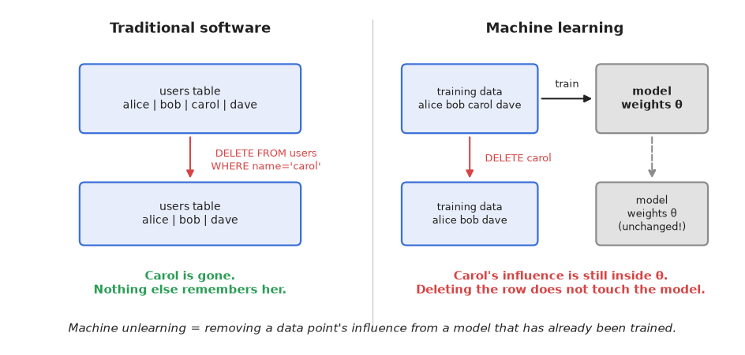
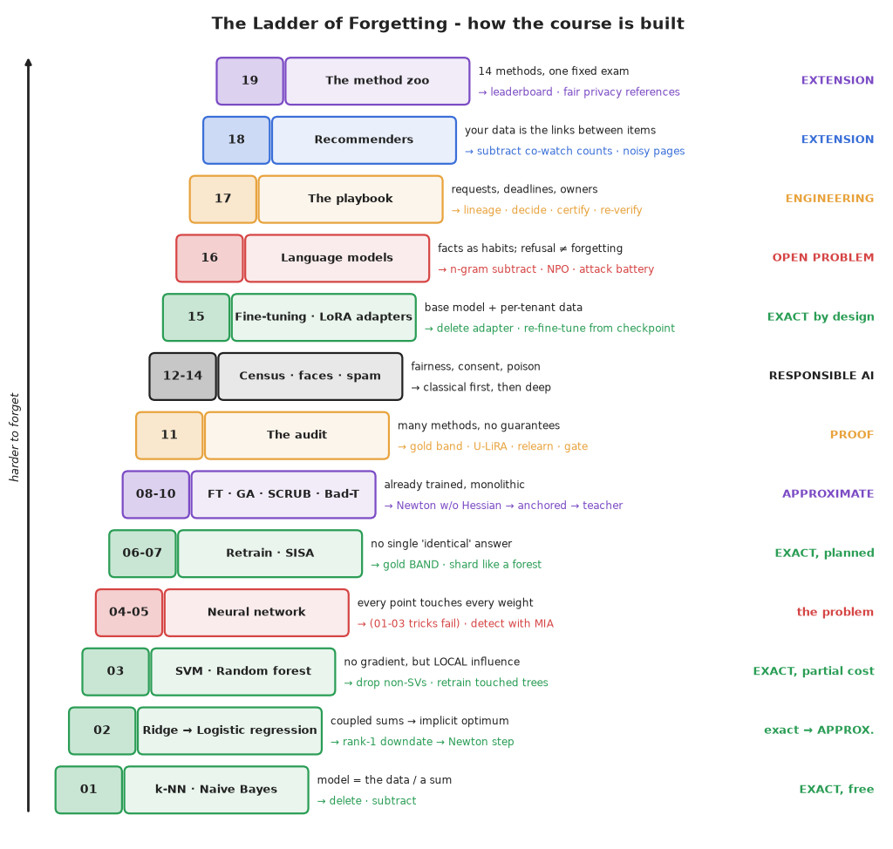

# Machine Unlearning for Responsible AI 🧹

**A hands-on course on making a trained model forget someone's data, and testing whether it really did.**

[](LICENSE)
[](requirements.txt)
[](#%EF%B8%8F-setup)
[](ROADMAP.md)
[](PRACTICE.md)
[](https://colab.research.google.com/github/Shreyan1/machine-unlearning-course/blob/main/00-ReadFIRST.ipynb)

### 💸 When a model learns the wrong thing, the usual fix is to train it again

Training a big model once already costs a fortune. Stanford's [AI Index 2024](https://aiindex.stanford.edu/report/)
estimates the compute alone at about **$78 million for GPT-4** and **$191 million for Gemini Ultra**. Meta's
[Llama 3 report](https://arxiv.org/abs/2407.21783) describes a 54-day run on 16,384 GPUs that was hit by 419
unexpected interruptions. So when bad, illegal or unwanted data turns up inside a trained model, "just retrain it" is
often the one fix a company cannot afford. And sometimes a regulator decides for them.

These are real cases. Each link goes to the regulator, the paper or a news report.

| Year | What went wrong | What it cost |
|---|---|---|
| 2016 | **Microsoft Tay**, a chatbot that learned from Twitter users, was taught offensive tweets by a coordinated attack. | Taken offline in under 24 hours, with a public apology. ([Microsoft](https://blogs.microsoft.com/blog/2016/03/25/learning-tays-introduction/)) |
| 2020 | **OpenAI GPT-3**: a bug let some benchmark test data stay in the training set. | The paper says that "due to the cost of training it was not feasible to retrain the model". The flaw shipped and was measured instead. ([paper, §1 and App. C](https://arxiv.org/abs/2005.14165)) |
| 2021 | **Everalbum** used customers' photos to build face recognition without proper consent. | US FTC ordered it to delete the face recognition **models and algorithms** built from those photos. ([FTC](https://www.ftc.gov/news-events/news/press-releases/2021/05/ftc-finalizes-settlement-photo-app-developer-related-misuse-facial-recognition-technology)) |
| 2021 | **Scatter Lab's "Lee Luda"** chatbot (South Korea) was trained on about 9.4 billion KakaoTalk messages from 600,000 people without valid consent. | Suspended 20 days after launch; the company said it would throw away the database and the trained models. KRW 103.3 million in fines. ([Korea Times](https://www.koreatimes.co.kr/amp/business/tech-science/20210115/ai-developer-to-discard-data-used-in-controversial-female-chatbot), [FPF](https://fpf.org/blog/south-korea-the-first-case-where-the-personal-information-protection-act-was-applied-to-an-ai-system/)) |
| 2022 | **WW (Weight Watchers) / Kurbo** collected children's data without parental consent. | $1.5 million penalty, plus delete the data and destroy any **models or algorithms** made from it. ([FTC](https://www.ftc.gov/news-events/news/press-releases/2022/03/ftc-takes-action-against-company-formerly-known-weight-watchers-illegally-collecting-kids-sensitive)) |
| 2022 | **Unity** took in bad data from a large customer, which spoiled the training data behind its ad-targeting model. | Unity estimated a **$110 million** hit to 2022 revenue; the stock fell 29% in after-hours trading. ([Motley Fool](https://www.fool.com/investing/2022/05/13/is-unity-software-stock-a-buy-now/)) |
| 2023 | **LAION-5B**, the image dataset behind popular image generators, was found to contain child sexual abuse material. | LAION pulled the dataset and released a cleaned one in 2024. Models already trained on it kept what they had learned; Stable Diffusion 1.5 was later taken off Hugging Face. ([Stanford](https://purl.stanford.edu/kh752sm9123), [TechCrunch](https://techcrunch.com/2024/08/30/the-org-behind-the-data-set-used-to-train-stable-diffusion-claims-it-has-removed-csam/), [IEEE Spectrum](https://spectrum.ieee.org/stable-diffusion)) |
| 2023 | **Ring** used customers' videos to train algorithms without consent. | $5.8 million, and delete the **models and algorithms** built from those videos. ([FTC](https://www.ftc.gov/news-events/news/press-releases/2023/05/ftc-says-ring-employees-illegally-surveilled-customers-failed-stop-hackers-taking-control-users)) |
| 2023 | **Rite Aid**'s face recognition wrongly flagged thousands of shoppers as shoplifters. | Five-year ban on face recognition; delete the photos and any **algorithms** built from them, and tell vendors to do the same. ([FTC](https://www.ftc.gov/news-events/news/press-releases/2023/12/rite-aid-banned-using-ai-facial-recognition-after-ftc-says-retailer-deployed-technology-without)) |
| 2024 | **OpenAI** trained ChatGPT on personal data without an adequate legal basis, said Italy's data protection authority. | €15 million fine. A Rome court cancelled it in March 2026 because Ireland, not Italy, was the lead regulator; the court did not rule on the training question itself. ([Garante](https://www.garanteprivacy.it/home/docweb/-/docweb-display/docweb/10085432)) |
| 2024 | **Clearview AI** built a face database from billions of scraped photos. | €30.5 million fine from the Dutch data protection authority. ([Hunton](https://www.hunton.com/privacy-and-cybersecurity-law-blog/dutch-regulator-fines-clearview-ai-30-5-million-euros)) |

The pattern is the same each time. The fine is not the biggest cost. The biggest cost is that the only fix that is
sure to work, training again without the bad data, costs as much as the first training, and the next problem or
deletion request needs it all over again. **Machine unlearning** asks a cheaper question: can we remove the influence of
just that data, and then check, with evidence, that it is gone?

> ⚠️ **Unlearning is not a legal safe harbour.** No regulator has yet said that any unlearning method counts as
> deleting the data. What the law actually requires depends on the case, and erasure rights have exceptions. This course
> teaches you to measure what a method does, so you can make that argument honestly. Problems 11 and 17 cover the
> evidence and the paperwork.

<p align="center"></p>

### Meet Carol

A digit-recognition model is trained on 1,257 handwritten digits. Forty of them were written by **Carol**, with a thick
marker that nobody else used. The model gets **100%** of her digits right, and it is clearly worse on thick-marker digits
it has never seen. It did not just learn "thick digits". It memorised *hers*.

Carol asks to be forgotten. The company deletes her rows from the database. **Nothing changes**: the weights are already
trained, and an attacker can still tell she was in the training data.

This course is about what to do next. Every problem follows the same five steps:

> **Train** a model → **show the issue** (it still remembers) → **untrain** it → **show the result** → **prove it**
> against models that never saw the data.

"Prove it" means gathering evidence. Attacks and tests can show that a model still remembers, but they cannot prove it
has forgotten. Only the deletion process itself (retraining, or SISA with a logged partition) gives a guarantee.

The target is not 0% on Carol. A model that never met her can still read many of her digits. The target is the
**gold band**: the range of results you get from several models retrained without her. Most unlearning tutorials get
this wrong, and this course is built around getting it right.

<p align="center">
  ▶️ <a href="https://colab.research.google.com/github/Shreyan1/machine-unlearning-course/blob/main/00-ReadFIRST.ipynb"><b>Start in Colab, no install</b></a>
  &nbsp;·&nbsp; 🧭 <a href="#-pick-your-path"><b>Pick your path</b></a>
  &nbsp;·&nbsp; 🪜 <a href="#-the-ladder-of-forgetting"><b>See all problems</b></a>
  &nbsp;·&nbsp; 🏋️ <a href="PRACTICE.md"><b>Practise</b></a>
</p>

---

### 🔎 Nine things this course shows

These are results from the course's own small experiments, with the settings in each notebook. They are not measurements
of large pretrained LLMs.

1. **Deleting is not forgetting.** In a neural network, every training example touches 94% of the weights. *(Problem 4)*
2. **"Forgotten" is a band, not a number.** Two retrains without Carol disagree with each other, so you need several. *(Problem 6)*
3. **Most quick fixes fail.** Of 46 fine-tune, gradient-ascent and NegGrad+ settings, only **1** passes the audit. *(Problem 8)*
4. **A method can grade itself too kindly.** Bad Teacher's own metric ranks it *above* the gold standard. *(Problem 10)*
5. **Erasure requests can hurt fairness.** On census data, skewed requests drop the model's true-positive rate for women while accuracy does not move. *(Problem 12)*
6. **Refusal is not forgetting.** A language model trained to say "(withheld)" for Dana's phone number can still be made to give it up, by prefix forcing or a little relearning. *(Problem 16)*
7. **Even an exact deletion can leak.** Comparing a recommender's public pages before and after a deletion tells an attacker what the deleted user watched, unless fresh noise is added. *(Problem 18)*
8. **Newer methods are not automatically better, and a privacy test can be fooled.** Fourteen methods sit one fixed exam: no approximate method forgets Carol, and methods that make the model less sure of *everything* look "forgotten" until the test's reference models are built the same way. *(Problem 19)*
9. **Retraining for every request does not scale.** The yearly bill grows with the *square* of the service size. SISA with 20 shards serves a year of 104 requests for about 2% of that cost and still matches, bit for bit, a fresh SISA model trained with the same shards and recipe, while exact Newton updates need a Hessian that a deep model cannot fit in memory. *(Problem 20)*

---

### 🧭 Pick your path

You do not have to do all 22 notebooks. Find the row that sounds like you. Each route takes the problems in order.

| You are... | Do these problems | Time |
|---|---|---|
| **New to unlearning** and want the whole idea | `00` → `01` → `04` → `06` → `07` → `08` → `11` | ~4 hrs |
| A **privacy, legal or governance** person who needs to judge an unlearning claim | `00` → `04` → `06` → `11` → `12` → `17` | ~4 hrs |
| An **ML researcher** comparing unlearning methods | `00` → `04` → `05` → `06` → `08` → `09` → `10` → `11` → `19` | ~6 hrs |
| An **LLM engineer** who needs a model to forget facts or a customer's fine-tune | `00` → `04` → `06` → `11` → `15` → `16` → `16b` | ~5 hrs |
| A **platform or MLOps engineer** designing systems that can delete | `00` → `06` → `07` → `11` → `15` → `17` → `18` → `20` | ~6 hrs |
| Doing **the full course** | everything, in order | ~19-27 hrs |

Times use the estimate at the top of each notebook and add a little for the tasks. The [ROADMAP](ROADMAP.md) has
the full stage-by-stage plan and a checkpoint for each stage.

---

### 👨‍💻 Before you start

- Python and NumPy at a working level; basic scikit-learn.
- Intermediate machine learning: what a loss function, gradient descent and overfitting are.
- No deep-learning framework needed. The neural networks are written in **pure NumPy**, so you can read every gradient.
- No legal background needed. Each legal idea is explained where it is used.

### 🛠️ Setup

```bash
python -m venv .mulvenv
source .mulvenv/bin/activate      # Windows: .mulvenv\Scripts\activate
pip install -r requirements.txt
python tests/test_mul.py          # gradient checks + exactness proofs, ~1 minute
```

No install? Every notebook has an **Open in Colab** badge. Run its first cell and it fetches the course library.

Every notebook runs end to end on a laptop CPU, most in under a minute. The small datasets (UCI Adult, SMS Spam,
Olivetti faces, sklearn digits, MovieLens) download once into `data/`. Only the optional Problem 16b needs PyTorch
(`pip install -r requirements-optional.txt`).

---

### 🪜 The Ladder of Forgetting

The problems are one argument, climbed one rung at a time. Each notebook ends with an **❓ Open question** that the
next one answers. Lower rungs are models where forgetting is a subtraction. The top rungs are LLMs, where nobody can
yet do it reliably.

<p align="center"></p>

Start with **`00-ReadFIRST.ipynb`** [](https://colab.research.google.com/github/Shreyan1/machine-unlearning-course/blob/main/00-ReadFIRST.ipynb): what unlearning is, why the law already demands it, the notation (D, D_f, D_r, θ_o, θ_r, θ_u) and a 60-second preview of the whole course with Carol.

Click a stage to see its problems.

<details>
<summary><b>🪜 Stage 1 · Classical ML</b>: when forgetting is a subtraction · Problems 1-3 · ~1.5 hrs</summary>
<br>

- **Problem 1:** k-NN and Naive Bayes. The model *is* the data, or a sum over it. Unlearning is a delete or a subtraction, and it is **bit-for-bit exact**. [](https://colab.research.google.com/github/Shreyan1/machine-unlearning-course/blob/main/01-Classical-kNN-and-NaiveBayes.ipynb)

- **Problem 2:** Linear and Logistic Regression. Coupled sums. Ridge gets an exact rank-one downdate; logistic regression needs a **Newton step** (influence functions, certified removal), the first *approximate* method. [](https://colab.research.google.com/github/Shreyan1/machine-unlearning-course/blob/main/02-Classical-Linear-and-Logistic-Regression.ipynb)

- **Problem 3:** SVM and Random Forest. No gradient, but *local* influence. Non-support vectors cost nothing to forget; a forest only retrains the trees that saw the point. [](https://colab.research.google.com/github/Shreyan1/machine-unlearning-course/blob/main/03-Classical-SVM-and-Random-Forest.ipynb)

</details>

<details>
<summary><b>🧠 Stage 2 · Neural networks</b>: the problem · Problems 4-5 · ~1 hr</summary>
<br>

- **Problem 4:** Deleting is not forgetting. Every example touches 94% of the weights, and unusual people like Carol are **memorised** (Feldman's long tail). The Problem 1-3 tricks all fail. [](https://colab.research.google.com/github/Shreyan1/machine-unlearning-course/blob/main/04-Neural-Nets-Deleting-Is-Not-Forgetting.ipynb)

- **Problem 5:** Membership inference. How an attacker tells whether *your* data was used. Loss attacks, and the per-example **U-LiRA** test that flags 95% of Carol's digits. [](https://colab.research.google.com/github/Shreyan1/machine-unlearning-course/blob/main/05-Membership-Inference-Attacks.ipynb)

</details>

<details>
<summary><b>✅ Stage 3 · Exact unlearning for neural nets</b> · Problems 6-7 · ~1 hr</summary>
<br>

- **Problem 6:** Retraining and the **gold band**. Two retrains differ, so "forgotten" is a *band*, not a number. [](https://colab.research.google.com/github/Shreyan1/machine-unlearning-course/blob/main/06-Retrain-and-the-Gold-Band.ipynb)

- **Problem 7:** SISA. Shard and checkpoint at training time; unlearning becomes bit-exact and, with a **user-aware partition**, costs ~5% of a retrain. Plus the *recipe trap* in auditing. [](https://colab.research.google.com/github/Shreyan1/machine-unlearning-course/blob/main/07-SISA-Exact-Unlearning-by-Design.ipynb)

</details>

<details>
<summary><b>⚡ Stage 4 · Approximate unlearning</b>: cheaper, and full of traps · Problems 8-10 · ~2 hrs</summary>
<br>

- **Problem 8:** Fine-tune, gradient ascent, NegGrad+, and the traps. Only **1 of 46** configurations passes the gate. [](https://colab.research.google.com/github/Shreyan1/machine-unlearning-course/blob/main/08-Approximate-Baselines-and-Traps.ipynb)

- **Problem 9:** SCRUB and SCRUB+R. A student that selectively disobeys its teacher. Works for class forgetting, but **over-forgets or relapses** on a memorised individual. [](https://colab.research.google.com/github/Shreyan1/machine-unlearning-course/blob/main/09-SCRUB-Teacher-Student-Unlearning.ipynb)

- **Problem 10:** Bad Teacher. Fast (under 1% of a retrain), but **random ≠ forgotten**, and its own metric ranks it above the gold standard. [](https://colab.research.google.com/github/Shreyan1/machine-unlearning-course/blob/main/10-Bad-Teacher-Unlearning.ipynb)

</details>

<details>
<summary><b>🔬 Stage 5 · Proof</b> · Problem 11 · ~45 min</summary>
<br>

- **Problem 11:** The Unlearning Audit. One pre-registered protocol, five checks (FORGET, PRIVACY, UTILITY, COST, **RELEARN**), three request types, machine-readable evidence. The best-looking approximate method is *suppressed*, not removed. [](https://colab.research.google.com/github/Shreyan1/machine-unlearning-course/blob/main/11-The-Unlearning-Audit.ipynb)

</details>

<details>
<summary><b>🌍 Stage 6 · Real-world Responsible AI</b>: fairness, faces, poison, fine-tunes, LLMs · Problems 12-16b · ~4 hrs</summary>
<br>

- **Problem 12:** Right to be Forgotten on the **Adult census** data. Skewed erasure requests collapse the model's true-positive rate for women while accuracy does not move, and NegGrad+ adds a **method-made bias**. Fairness monitoring and mitigation. [](https://colab.research.google.com/github/Shreyan1/machine-unlearning-course/blob/main/12-Right-to-be-Forgotten-and-Fairness.ipynb)

- **Problem 13:** Consent withdrawn in **face recognition** (Olivetti). Exact eigenface unlearning, neural identity forgetting, and why **memory ≠ capability**. [](https://colab.research.google.com/github/Shreyan1/machine-unlearning-course/blob/main/13-Consent-Withdrawal-Face-Recognition.ipynb)

- **Problem 14:** A **poisoned** SMS spam filter. A backdoor that exact unlearning cannot remove when only part of the poison is found, and a fix that works with 10% detection. [](https://colab.research.google.com/github/Shreyan1/machine-unlearning-course/blob/main/14-Poisoned-Data-and-Backdoors.ipynb)

- **Problem 15:** **Fine-tuning and un-finetuning** for an enterprise SaaS. Per-tenant LoRA adapters (deletion is exact and free), re-fine-tuning from checkpoints, task-vector negation, and the lineage cascade. [](https://colab.research.google.com/github/Shreyan1/machine-unlearning-course/blob/main/15-Fine-Tuning-and-Un-Finetuning.ipynb)

- **Problem 16:** **LLM unlearning.** Forgetting a phone number a language model can recite. n-gram subtraction, gradient ascent, NPO, refusal training, exposure, prefix forcing and the relearn attack: **refusal ≠ forgetting**. [](https://colab.research.google.com/github/Shreyan1/machine-unlearning-course/blob/main/16-LLM-Unlearning-Facts-Not-Rows.ipynb)

- **Problem 16b (optional, PyTorch):** the same lesson on a small GPT-style transformer. [](https://colab.research.google.com/github/Shreyan1/machine-unlearning-course/blob/main/16b-LLM-Unlearning-PyTorch.ipynb)

</details>

<details>
<summary><b>🏢 Stage 7 · Engineering</b>: a deletion request, end to end · Problem 17 · ~45 min</summary>
<br>

- **Problem 17:** The enterprise playbook. Lineage registry, decision procedure, deadline planning, a **re-verifiable unlearning certificate**, owners for every threshold, and an Unlearning pillar for the RAI Scorecard. [](https://colab.research.google.com/github/Shreyan1/machine-unlearning-course/blob/main/17-Enterprise-Unlearning-Playbook.ipynb)

</details>

<details>
<summary><b>🧩 Stage 8 · Extensions</b>: the same ideas in new places · Problems 18-20 · ~2 hrs</summary>
<br>

- **Problem 18:** **Recommender systems** on real MovieLens data. Erin, a user with unusual taste, is on other people's "also watched" pages. Item-kNN forgets her **exactly** with a subtraction; matrix factorisation needs a retrain; and comparing the public pages before and after a deletion **reveals what was deleted**, unless you add fresh noise. [](https://colab.research.google.com/github/Shreyan1/machine-unlearning-course/blob/main/18-Recommender-Systems-Your-Taste-on-Every-Page.ipynb)

- **Problem 19:** **The method zoo.** Fourteen methods, from retraining to SalUn and SSD, sit Problem 11's exam on three requests, labelled by family (model-agnostic, model-intrinsic, data-driven). No approximate method forgets Carol, and the new methods' passes on the random request turn out to be a **confidence trick** that only a fairly built privacy test catches. [](https://colab.research.google.com/github/Shreyan1/machine-unlearning-course/blob/main/19-The-Method-Zoo.ipynb)

- **Problem 20:** **Unlearning at scale.** A year of deletion requests, two a week. Retraining for every request costs 104 retrains; batching monthly costs 13; **SISA with 20 shards costs about 2**, and a formula predicts how many shards each batch touches. After the whole year SISA is still **bit-for-bit** equal to a fresh SISA model (same shards, same recipe) trained without the deleted users. Exact Newton updates do not drift, but their Hessian grows with the square of the weights. [](https://colab.research.google.com/github/Shreyan1/machine-unlearning-course/blob/main/20-Unlearning-at-Scale.ipynb)

</details>

🏋️ **Want to test yourself?** [PRACTICE.md](PRACTICE.md) has **40 unsolved problems** in four tiers (Beginner, Amateur,
Semi-Pro and Pro), each with a hint, references and a checkable "done when".

---

### 🧰 What is in the box

```
00-ReadFIRST.ipynb … 20-Unlearning-at-Scale.ipynb   the course (22 notebooks)
mul/            a small, readable "Machine UnLearning" library the notebooks share
  nn.py         NumPy MLP + Adam + LoRA adapters (hand-written, gradient-checked)
  classical.py  exact unlearning for k-NN, Naive Bayes, ridge, logistic (Newton), forests, SVM
  methods.py    retrain, SISA, fine-tune, gradient ascent, NegGrad+, SCRUB(+R), Bad Teacher,
                random labels, SalUn, L1-sparse, UNSIR, SSD, last-layer re-solve
  audit.py      MIA, U-LiRA, gold band, relearn test, the gate
  lm.py         n-gram + neural character LMs, exposure, NPO
  recsys.py     item-kNN (exact unlearning), matrix factorisation, "also watched" pages, the diff attack
  lab.py, data.py, viz.py, train.py, torch_models.py (optional)
tests/          gradient checks and exactness proofs:  python tests/test_mul.py
assets/         diagrams (generated by assets/make_diagrams.py)
results/        audit evidence records, the certificate and the leaderboard (Problems 11, 17, 19)
resources/      49 papers (links, licences, open-licence text), a catalogue, a citation audit,
                and fetch_papers.py to download the PDFs
templates/      the starting notebook for a new problem (see CONTRIBUTING.md)
```

---

### 🤓 What to read

All papers below are catalogued in [`resources/`](resources/README.md), with a suggested reading order.
`python resources/fetch_papers.py` downloads the PDFs to the paths the notebooks cite.

<details>
<summary><b>📑 Foundational papers</b></summary>
<br>

1. [Towards Making Systems Forget with Machine Unlearning](https://www.ieee-security.org/TC/SP2015/papers-archived/6949a463.pdf) - Cao & Yang 2015 - *Problem 1*
2. [Certified Data Removal from Machine Learning Models](https://arxiv.org/abs/1911.03030) - Guo et al. 2019 - *Problems 2, 12*
3. [Machine Unlearning (SISA)](https://arxiv.org/abs/1912.03817) - Bourtoule et al. 2019 - *Problem 7*
4. [Does Learning Require Memorization?](https://arxiv.org/abs/1906.05271) - Feldman 2020 - *Problem 4*

</details>

<details>
<summary><b>📄 Papers behind Problems 5-20</b></summary>
<br>

5. [Membership Inference Attacks From First Principles (LiRA)](https://arxiv.org/abs/2112.03570) - *Problem 5*
6. [Inexact Unlearning Needs More Careful Evaluations (U-LiRA)](https://arxiv.org/abs/2403.01218) - *Problems 5, 11*
7. [Towards Unbounded Machine Unlearning (SCRUB)](https://arxiv.org/abs/2302.09880) - *Problem 9*
8. [Can Bad Teaching Induce Forgetting? (Bad Teacher)](https://arxiv.org/abs/2205.08096) - *Problem 10*
9. [On the Necessity of Auditable Algorithmic Definitions for Machine Unlearning](https://arxiv.org/abs/2110.11891) - *Problems 11, 17*
10. [Machine Unlearning Fails to Remove Data Poisoning Attacks](https://arxiv.org/abs/2406.17216) - *Problem 14*
11. [LoRA](https://arxiv.org/abs/2106.09685) and [Editing Models with Task Arithmetic](https://arxiv.org/abs/2212.04089) - *Problem 15*
12. [The Secret Sharer (exposure)](https://arxiv.org/abs/1802.08232) - *Problem 16*
13. [Negative Preference Optimization](https://arxiv.org/abs/2404.05868) - *Problem 16*
14. [Eight Methods to Evaluate Robust Unlearning in LLMs](https://arxiv.org/abs/2402.16835) and [Do Unlearning Methods Remove Information from LLM Weights?](https://arxiv.org/abs/2410.08827) - *Problem 16*
15. [Recommendation Unlearning (RecEraser)](https://arxiv.org/abs/2201.06820) and [When Machine Unlearning Jeopardizes Privacy](https://arxiv.org/abs/2005.02205) - *Problem 18*
16. [SalUn](https://arxiv.org/abs/2310.12508), [Selective Synaptic Dampening](https://arxiv.org/abs/2308.07707), [Model Sparsity Can Simplify Machine Unlearning](https://arxiv.org/abs/2304.04934), [UNSIR](https://arxiv.org/abs/2111.08947) and [Amnesiac Machine Learning](https://arxiv.org/abs/2010.10981) - *Problem 19*
17. [Machine Unlearning (SISA)](https://arxiv.org/abs/1912.03817) and [Certified Data Removal](https://arxiv.org/abs/1911.03030), read again for cost at scale - *Problem 20*

</details>

<details>
<summary><b>📚 Books and surveys</b></summary>
<br>

1. *The Architect's Handbook: Engineering Responsible AI* by Shreyan Basu Ray - §5.1 on machine unlearning and the RAI Scorecard (in `resources/book/`).
2. [A Survey of Machine Unlearning](https://arxiv.org/abs/2209.02299) - Nguyen et al.
3. [Rethinking Machine Unlearning for Large Language Models](https://arxiv.org/abs/2402.08787) - Liu et al.

</details>

<details>
<summary><b>⚖️ Regulation the course refers to</b></summary>
<br>

- GDPR Art. 17 (right to erasure), Art. 7(3) (withdrawal of consent), Art. 9 (biometric data), Art. 12(3) (one-month response, extendable by two more months)
- EDPB Opinion 28/2024 on AI models and personal data
- India DPDP Act 2023 s.12 · California CCPA §1798.105
- FTC orders requiring deletion of models: Everalbum (2021), WW/Kurbo (2022), Rite Aid (2023)

</details>

---

### ❓ FAQ

**What is machine unlearning?** Removing the influence of specific training data from an already-trained model, so it
behaves like a model that was never trained on that data. Deleting the data from a database is not enough.

**Why does Responsible AI need it?** Privacy laws (GDPR Art. 17, India's DPDP Act, CCPA) give people the right to erasure,
regulators such as the FTC have ordered companies to delete models built on unlawfully used data, and poisoned or
copyrighted data has to be removed from deployed models. The law does not always demand that model weights change, and
no regulator has approved any unlearning method as equal to deletion yet. See the cases at the top of this page.

**What is the difference between exact and approximate unlearning?** Exact unlearning (retraining, SISA, Naive Bayes
subtraction, deleting a LoRA adapter) provably gives the same model as retraining without the data *using the same
setup*. For SISA that means the same shards and training recipe, not an ordinary model trained on all the remaining
data. Approximate unlearning
(gradient ascent, NegGrad+, SCRUB, Bad Teacher, NPO) is cheaper but must be audited. See Problem 11.

**How do you prove a model forgot?** Compare it with models retrained without the data (the *gold band*), and attack it:
membership inference (U-LiRA), the relearn attack, and for LLMs exposure and prefix forcing.

**Can LLMs really unlearn?** Often they only *suppress*: refusal training hides a fact that prefix forcing and relearning
bring back (Problems 16 and 16b). Re-fine-tuning from a clean checkpoint is the reliable route.

**Do I need a GPU or PyTorch?** No. Everything runs on a CPU in pure NumPy; only the optional Problem 16b uses PyTorch.

**Keywords:** machine unlearning, right to be forgotten, data deletion, GDPR, responsible AI, AI privacy, membership
inference, SISA, SCRUB, Bad Teacher, NPO, LLM unlearning, LoRA unlearning, un-finetuning, data poisoning, AI governance.

---

### 🤝 Contributing

Found a bug, a wrong number or a confusing sentence? Want to add a new problem? You are very welcome. Read
[CONTRIBUTING.md](CONTRIBUTING.md) first. New problems start from
[`templates/problem-template.ipynb`](templates/problem-template.ipynb), so every notebook keeps the same five steps.

### 📌 Citing

If you use this course in teaching or research, please cite it. GitHub's **"Cite this repository"** button (from
[CITATION.cff](CITATION.cff)) gives you BibTeX and APA.

---
#### Connect with me 🪩

[](https://x.com/shreyanbr)
[](https://linkedin.com/in/shreyanbasuray)
[](https://shreyanbasuray.com)

─── ⋆⋅☆⋅⋆ ───
